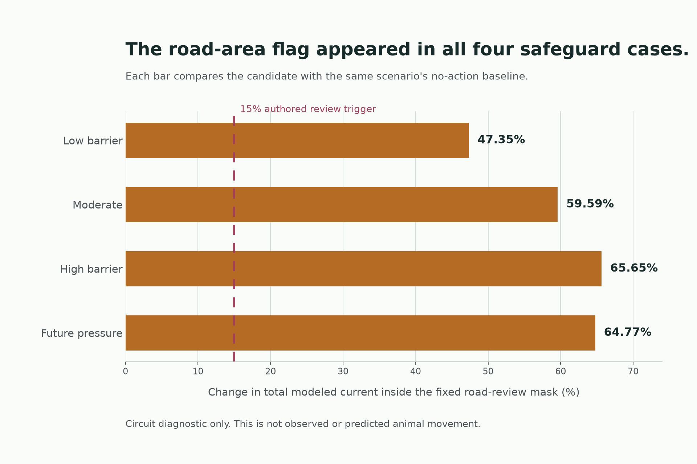
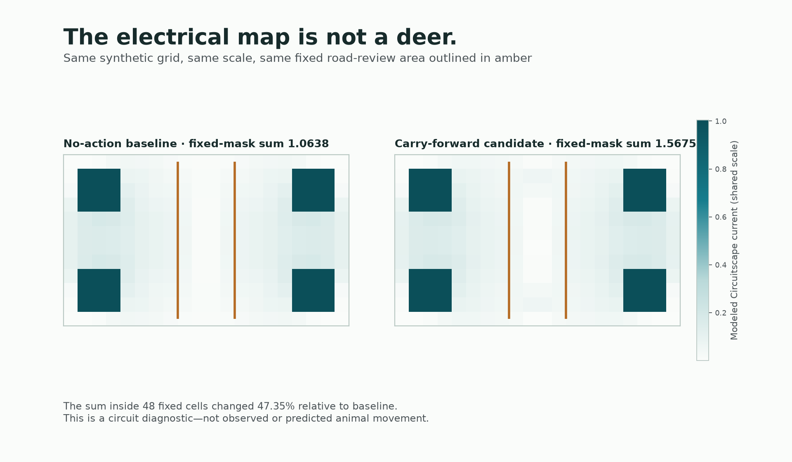
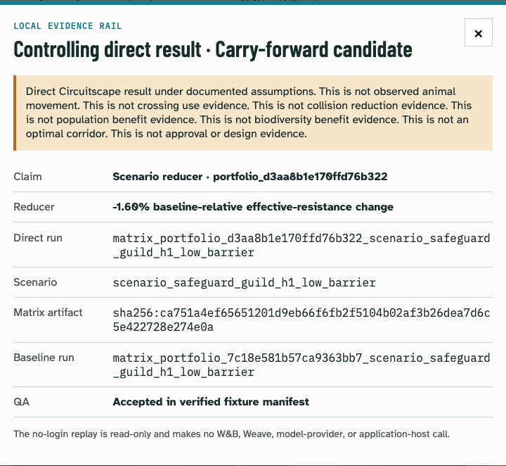
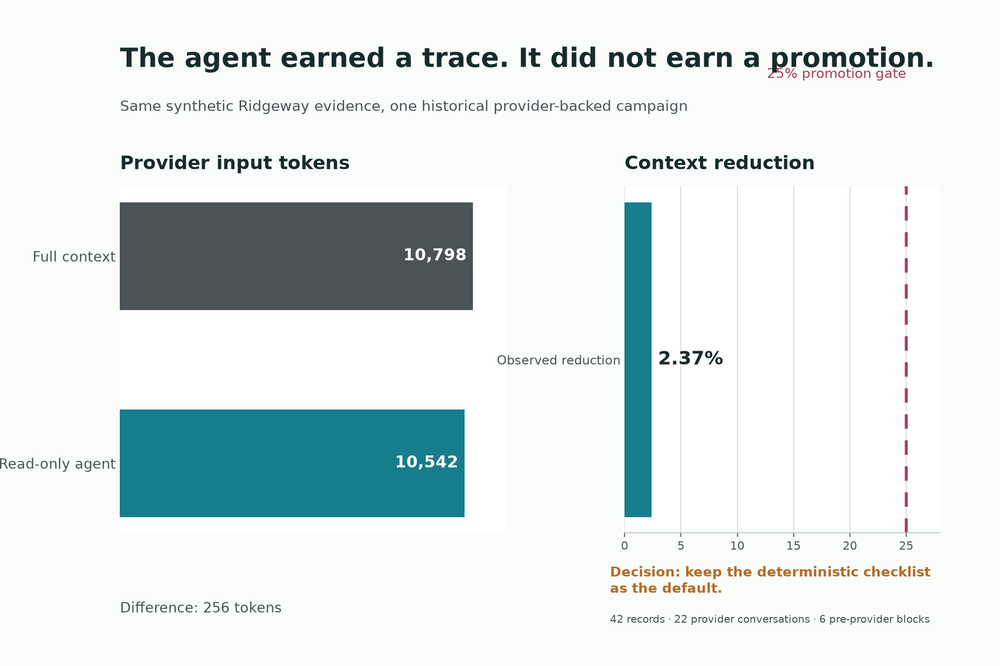

# The Model Passed. We Sent a Human to the Road.

_A synthetic wildlife-connectivity study, an AI agent we kept experimental, and what I now think environmental software is actually for._

Ridgeway is a fictional highway study. A portfolio is simply one bundle of reviewed crossing, fencing, and restoration concepts. We tested 128 of those bundles across 12 different sets of ecological assumptions. One portfolio under one set of assumptions became one direct solver job.

Then we reran the no-action baseline and four teaching portfolios with diagnostic current maps. The solver was Circuitscape, which uses an electrical-circuit analogy to compare modeled landscape connectivity.

That gave us 1,596 direct Circuitscape jobs.

The option we wanted to carry forward cost $400,000 against a $500,000 screening cap. All 12 modeled scenarios completed, and none failed the connectivity checks we had defined. Even the least favorable safeguard case showed a 1.6031% decrease in modeled effective resistance relative to baseline.

The most useful result was still:

> Go look at the road.

At first, this felt like we had built an elaborate machine to print common sense. Then it became the clearest sign that we had built the right kind of machine.

<!-- ECOVIS:ridgeway-decision -->


_Three favorable checks did not erase the separate road-area review flag. The supported action was further ecological, field, and engineering review—not approval._
<!-- /ECOVIS -->

## We wanted a shortlist, not a verdict

EcoCorridor Scenario Studio started from a fairly ordinary professional problem.

A transportation environmental team may have several crossing, fencing, or habitat-restoration concepts. Each could behave differently for different species groups, future conditions, or assumptions about how difficult the surrounding landscape is to move through. The team also has costs, safeguards, missing field evidence, maintenance questions, and enough maps to threaten an otherwise innocent conference table.

The question is not:

> Can a model find the wildlife corridor?

The model cannot observe an animal, negotiate land access, inspect a culvert, confirm fence-end treatment, or discover that the soil does something exciting after rain.

The useful question is narrower:

> Which options still look worth investigating after we test them against every required modeled scenario and keep the unresolved field questions attached?

We built Ridgeway Crossing to exercise that question without pretending a public demo was a real place.

Ridgeway is entirely synthetic and released as CC0 test material. It has four habitat cores separated by one highway. We added two anonymous target animal groups, one safeguard group, four reviewed assumptions about landscape resistance, eight possible intervention sites, and 128 fixed portfolios.

No threatened-species locations are hiding behind cheerful aliases. Ridgeway is a software and reasoning drill.

For every portfolio, we ran all 12 required ecological scenarios directly through [Circuitscape](https://docs.circuitscape.org/Circuitscape.jl/latest/usage/). That produced 1,536 direct connectivity comparisons. We then produced 60 additional diagnostic maps for the baseline and four teaching portfolios.

We retained the direct results, quality checks, scenario identities, input hashes, and artifacts. We can reproduce these saved synthetic runs locally. That does not make them a field study, an independent ecological review, or proof that the assumptions are right.

That distinction is boring right up until somebody needs it.

## One number refused to cooperate

The first pass through the candidate looked reassuring:

- All 12 scenario ensembles completed, and none failed its required pairwise effective-resistance screen.
- The $400,000 synthetic screening cost fit under the $500,000 cap.
- The least favorable safeguard case still had 1.6031% lower modeled effective resistance than its no-action baseline.
- Every required direct job produced the expected output and passed the fixture's numerical and artifact-integrity checks.

This is the point where a result begins trying on more authoritative language.

“Complete” becomes “validated.”

“Under budget” becomes “feasible.”

“Did not fail” begins eyeing “recommended.”

We built EcoCorridor partly to make that costume change harder.

Before we ran Ridgeway, we fixed a 48-cell area around the highway for additional review. For each safeguard assumption, the application compared the sum of modeled Circuitscape current inside those same cells for the candidate and the no-action baseline.

Across the four safeguard cases, that total changed by 47.35% to 65.65%. The chart keeps the exact values.

Every value exceeded the authored 15% investigation trigger.

<!-- ECOVIS:road-mask-hypotheses -->


_The warning did not depend on only one landscape assumption. It appeared in all four safeguard scenarios. The 15% line is an authored synthetic investigation trigger, not a biological threshold._
<!-- /ECOVIS -->

That does not tell us the portfolio caused harm. It does not estimate collision risk. It does not tell us that more animals will use the road.

It says the sum of modeled current inside the fixed road-review area changed substantially—an area we had already decided deserved attention.

The proper next step is to inspect the model assumptions, intervention footprint, road context, field conditions, and feasibility evidence.

In plainer English: go look at the road.

## The electrical map is not a deer

Circuitscape uses an electrical-circuit analogy. Habitat areas act like endpoints. Each landscape cell receives a reviewed resistance value describing how difficult movement is assumed to be through that cell. The solver calculates effective resistance between habitat areas and produces a current surface showing how the modeled electrical signal distributes through the landscape.

Lower effective resistance can mean the modeled connection became less difficult under that particular set of assumptions.

The current map is more delicate. It is useful for seeing where the modeled signal concentrates or changes, but it is still electrical current in a mathematical analogy.

It is not a deer.

It does not show observed travel, predict whether an animal will use a crossing, estimate collisions avoided, or establish a population benefit. A convincing color ramp does not upgrade the underlying claim. Cartography has enough power already.

The picture below compares the retained baseline and candidate current maps for the controlling low-barrier safeguard case. They use one shared scale and the same fixed mask.

<!-- ECOVIS:road-mask-current-maps -->


_Same synthetic landscape, numerical scale, and fixed review area. We summed modeled electrical current inside the outlined cells. We did not observe an animal moving through them._
<!-- /ECOVIS -->

The baseline sum inside the fixed mask was 1.0638. The candidate sum was 1.5675. Their baseline-relative difference was 47.3470%.

Those are sums of raster-cell values, not physical observations. They belong to this animal group and model setup and should not be compared across unrelated models. Their job is much smaller: to make one authored review rule reproducible inside one declared scenario.

## Every number gets a receipt

A careful disclaimer is useful. A reconstructable claim is better.

Clicking the controlling 1.6031% result opens an Evidence Rail that shows how the percentage was calculated, the candidate and baseline direct jobs, the exact scenario, the saved matrix hash, and the numerical QA disposition.

<!-- ECOVIS:evidence-rail-receipt -->


_The 1.6031% value has a direct run, baseline, artifact hash, and QA disposition. That makes the calculation auditable. It does not make the ecological assumptions true._
<!-- /ECOVIS -->

This distinction matters. The retained hash lets us verify exactly which saved artifact the calculation used. It cannot prove that a resistance surface represents an animal’s movement process or that an intervention is appropriate.

Software provenance and ecological validity are different jobs. We need both. Pretending one quietly supplies the other is how polished evidence packages become dangerous.

## The review flag was the product

A normal modeling summary could have stopped here:

> Under budget. All scenarios complete. No required pairwise effective-resistance screen failed.

That summary would be factually defensible and professionally unhelpful.

The road-area result did not invalidate the favorable findings. It changed what they were allowed to mean.

This is the part of environmental software I care about more now: keeping favorable and cautionary evidence side by side instead of averaging it into a pleasant status color.

EcoCorridor keeps several things separate:

- target results from safeguard results;
- one resistance hypothesis from another;
- modeled effective resistance from diagnostic current maps;
- screening cost from constructability;
- complete numerical runs from complete field evidence; and
- “worth investigating” from “ready to build.”

The software does not make the assumptions true. It makes it harder to forget which claim belongs to which evidence.

That is a less glamorous promise than automatic ecological design. It is also one I am more comfortable defending.

## Then we got greedy and added an agent

Once we had the evidence organized, the obvious AI question arrived.

Could an agent inspect the selected portfolio and prepare a useful field-review brief without reading the entire evidence package?

This is a reasonable job for an agent. A review record can contain safeguard findings, gaps in the model evidence, costs, ownership questions, maintenance assumptions, run references, and several branches that have nothing to do with the selected portfolio.

A human should not have to open all of it just to find the five things that matter.

So we built a bounded Review Brief Agent. It received a small, approved copy of the relevant evidence and read-only tools that could open only named findings and status checks.

It could not alter a resistance value, rerun the model, approve a portfolio, dismiss a failed check, invent an ecological number, browse local files, or write the visible brief in free-form prose.

The model could select only IDs from known findings. Ordinary local code supplied the words, numbers, units, limitations, and evidence links.

We recorded the real model turns and tool calls with [W&B Weave](https://docs.wandb.ai/weave/guides/tracking/tracing). If the model selected an unauthorized finding, failed the local checks, or left no complete call record to read back, no draft was saved.

<!-- ECOVIS:evidence-handoff -->


_The agent sits after direct evidence and fixed local checks. It can organize only the approved evidence it receives. Failed evidence creates no comparison or draft, and only a practitioner chooses what to investigate next._
<!-- /ECOVIS -->

This was the safety boundary we were willing to test.

It did not demonstrate that the agent was useful.

## The experiment called our bluff

The historical campaign compared three methods: a fixed checklist, one model call given the whole evidence package, and the read-only agent. The practical question was whether the agent could send materially less evidence to the model without losing a required finding.

The full-context comparison used 10,798 input tokens. The agent workflow used 10,542.

That is 256 fewer tokens, or a 2.37% reduction.

We had declared a 25% promotion gate before reading the result. The agent missed it by enough that rounding could not offer emotional support.

The deterministic checklist remained the default workflow.

<!-- ECOVIS:agent-promotion-gate -->


_The agent saved 256 provider-input tokens—2.37%, not the required 25%. The deterministic checklist stayed default._
<!-- /ECOVIS -->

The campaign contained 42 scored records: 14 deterministic local-control records, 22 real provider conversations retained as Weave traces, and six unsafe or invalid cases blocked before a provider call.

That supports a narrow claim: we could reconstruct the recorded calls end to end, and blocked cases produced no draft.

It does not support “the agent improved the product.”

Worse, the comparison was not fair enough to answer the larger usefulness question. We forced the supposed agent through the same sequence of tools instead of allowing it to choose what evidence to inspect or when to stop. Meanwhile, the full-context prompt listed what a valid answer should contain.

One side followed a script. The other got hints.

We had tested plumbing and given it an agent name. That one is on us.

## Ridgeway and the agent taught us the same lesson

The ecological result and the AI result look unrelated, but they failed in the same useful way.

Ridgeway produced favorable connectivity and cost evidence. The road-area diagnostic stopped us from promoting that into approval.

The agent produced valid traces and outputs that passed the pinned local checks under those recorded conditions. The efficiency gate stopped us from promoting that into a product improvement.

In both cases, the tempting headline was true:

- the portfolio met its pairwise modeled effective-resistance and synthetic screening-cost screens;
- the agent completed its bounded task.

In both cases, the next claim had not been earned:

- the portfolio was not ready to build;
- the agent was not ready to replace the deterministic workflow.

This is why I no longer think the logs and traces are just debugging receipts.

They tell us whether a result earned permission to change the default—and when it did not.

A model result should retain the assumptions that limit it. An agent result should retain the experiment that limits it. The software should make it difficult for either one to acquire authority through a nice summary.

## What is true, and what is still a plan

We have done enough work that a list of future experiments can begin to sound suspiciously like results. Here is the honest split.

**Observed in Ridgeway:** 1,536 direct connectivity comparisons and 60 direct diagnostic-map runs from a synthetic CC0 fixture. The application preserved favorable and cautionary evidence together and stopped at review in this authored case.

**Observed in the agent campaign:** 42 scored records, including 22 provider-backed Weave conversations and six pre-provider blocks. We could read back the recorded calls, and blocked cases produced no draft.

**Current product decision:** the deterministic checklist remains the default. The Review Brief Agent remains experimental.

**Not demonstrated:** practitioner workflow improvement, ecological validity, animal movement, crossing use, collision reduction, population response, biodiversity benefit, regulatory approval, or a design-ready crossing.

**Still planned:** test whether an agent can choose less evidence without missing anything, whether the safeguards survive deliberate attacks, and whether practitioners actually review faster or more accurately. A protocol is not a result.

The next agent experiment has to fix the question before collecting more traces. Every method should receive the same evidence and the same answer format. The agent should choose what it reads and when it stops. We should keep one control agent that deliberately opens everything. If the selective agent cannot beat that control, tool use itself did not create the benefit.

Then the agent has to do more than shave a few tokens. It must retain every critical finding, inspect materially less irrelevant evidence, and save no draft when evidence, authorization, validation, or trace readback is missing. It must also remain safe across stale evidence, injected instructions, sensitive locations, malformed output, and trace failures.

After that, practitioners—not another model grading prose—need to tell us whether the workflow reduces missed safeguards or verification time without increasing false alarms.

Those are experiments we intend to run. They are not hidden achievements waiting for better marketing.

## The awkward evidence is the point

Environmental decisions are full of evidence that is individually reasonable and jointly awkward.

A modeled connection improves, but only under one hypothesis.

A candidate fits a budget, but land access is unresolved.

A safeguard's modeled resistance does not worsen, but modeled current changes sharply inside the predefined road-review area.

An agent produces a polished brief, but we did not demonstrate that it reduced review work enough to justify another moving part.

The pressure is always toward one answer.

Sometimes that pressure comes from a meeting. Sometimes it comes from a dashboard. Increasingly, it comes from a model that can turn an uneven evidence record into an extremely smooth paragraph.

Good software should not merely make the paragraph smoother.

It should keep the awkward parts attached.

For now, EcoCorridor’s division of labor is simple:

```text
Circuitscape calculates the declared scenario.
The application preserves and checks the evidence.
An agent may organize a bounded subset if it proves useful.
A qualified practitioner decides what happens next.
```

Ridgeway does not show that we found a wildlife corridor. The agent campaign does not show that AI improved ecological review.

What we did show is smaller: a favorable result can remain favorable without being allowed to masquerade as a decision.

We ran 1,596 direct jobs to earn the right to say, “go look at the road.”

I now think that is exactly what useful environmental decision software should be able to do.

---

_Ridgeway Crossing is synthetic CC0 teaching material. All reported numerical values in this article come from its pinned direct-evidence projection or the recorded historical Review Brief campaign. W&B keeps the campaign record; Weave keeps the model and tool-call traces. Neither decides whether an ecological conclusion is valid._
