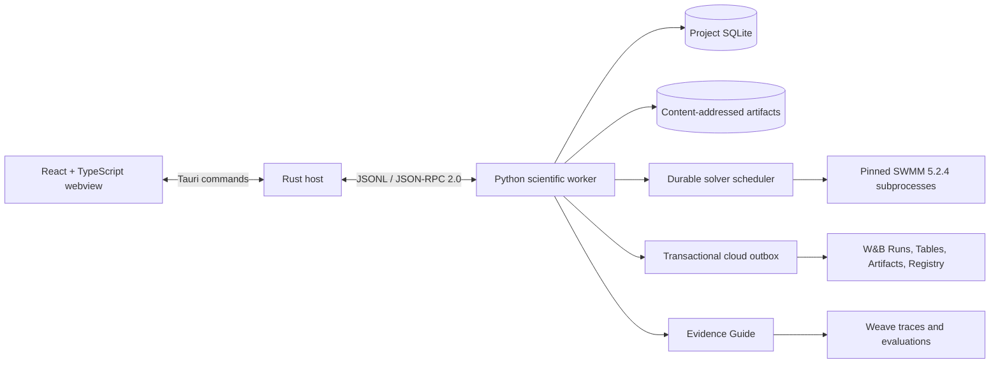
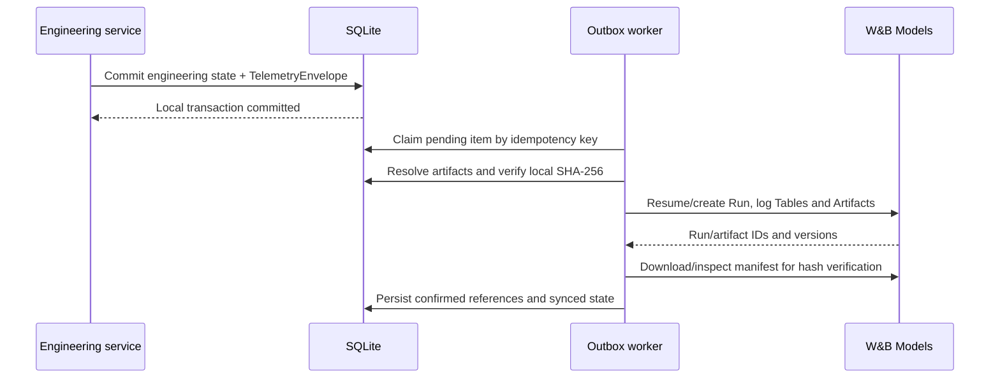

# Desktop platform architecture

## System outcome and authority

GI Scenario Studio is a decision workbench around a pinned EPA SWMM engine. It
turns an engineer's fit-for-purpose model into a reviewable GI shortlist. Every
reportable hydraulic value must resolve to a direct SWMM job. Search and ML may
choose a candidate to evaluate; they never supply a hydraulic result.

The local project database and content-addressed artifacts are authoritative.
W&B Models mirrors computation, lineage, and engineering evidence. The optional
Evidence Guide uses the one- or two-call finite-plan architecture pinned by its
v2 release receipt and records routing, selected read tools, plan selection,
and deterministic validation as an acknowledged Weave Agents turn. Neither
cloud service is a hydraulic, model-fitness, or regulatory authority.

This is the target staff-engineer architecture. The source MVP implements the
authoritative worker, exact guided evidence, durable solver state, four automatic
W&B producer projections, and the provider-backed, locally validated Evidence
Guide with Weave Agents traces. Full conceptual-data provenance/projection,
producer-atomic outbox insertion, a host-owned credential prompt, and signed
installer publication remain release gates. Real provider evaluation evidence is
published, and its checked decision is to keep the live Guide disabled.



## Process boundaries

### React renderer

The renderer owns accessible interaction and disposable view state. It submits
IDs, user decisions, and typed commands; it does not originate hydraulic values,
hashes, QA status, model fitness, cloud policy, or export attachments.

The webview has no broad filesystem or arbitrary shell capability. W&B links in
the interface are references returned by the authoritative worker after a
confirmed upload; constructing a plausible URL in the renderer is not evidence
that an upload or trace exists.

### Tauri host

The Rust host owns:

- application windows and lifecycle;
- native file dialogs and permitted project roots;
- start, supervision, framing, and shutdown of the scientific worker;
- macOS Keychain or Windows Credential Manager access;
- the narrow credential-store, credential-status, and credential-delete
  commands; and
- insertion of a stored credential into an authorized in-memory connection
  request.

It never parses SWMM, changes a model, computes a metric, ranks an alternative,
or decides fitness or export eligibility.

### Python scientific worker

The worker is the sole SQLite writer and owns domain validation, secure bundle
materialization, source-data provenance, conceptual model generation, model
fitness, typed mutations, exact-run planning, scheduling, metrics, QA, search,
decision evidence, exports, telemetry projection, cloud synchronization, and
assistant validation.

Services communicate through Pydantic domain objects rather than untyped
renderer dictionaries. Schema `2.0` is a breaking public contract; there is no
runtime compatibility shim for schema `1.0` payloads.

### SWMM subprocesses

One exact solver job represents one design vector under one storm. Each process
runs in its own normalized work directory, is launched without a shell, receives
only explicit input/report/output paths, and uses `OMP_NUM_THREADS=1`. A failed
job cannot corrupt another job or the worker database.

## Native command and credential boundary

The renderer can call the worker lifecycle methods and the three credential
commands exposed by the host. It cannot ask the host for the plaintext value of
a stored credential. The production target for an observability connection is:

1. The host validates a bounded, path-free credential ID.
2. The keychain persists the secret under the application service name.
3. The renderer sends only the credential ID in the worker request.
4. Rust retrieves the secret and adds it to that request in memory.
5. The worker authenticates, verifies project policy, and discards the secret.

The secret is not inherited by the worker process, placed in a process argument,
written to SQLite, returned in JSON-RPC, or included in diagnostics. The
provider-backed Evidence Guide reuses the verified in-memory W&B credential only
for the W&B Inference HTTPS authorization header. It does not create a second
provider secret, expose that credential to the renderer, or place it in a
provider or Weave payload.

Initial entry uses a host-owned masked password dialog. The resulting buffer is
length-checked, written directly to the OS keychain, and zeroized by Rust. The
renderer receives only `CredentialStatus`; no command accepts a plaintext key
from the webview.

The browser-only development preview has no keychain and cannot authenticate.
It may exercise layout and validation states but must label every cloud link as
a preview and cannot satisfy the production binding gate.

## Versioned JSON-RPC transport

The bundled worker communicates with the host over newline-delimited UTF-8
JSON-RPC 2.0 on standard input and output. Each line is at most 8 MiB. Stdout is
protocol-only; non-JSON output is a protocol failure. Stderr is retained for a
redacted local diagnostic path and is never broadcast as a global renderer
event.

Requests use Rust-assigned numeric IDs:

```json
{"jsonrpc":"2.0","id":1,"method":"project.get_state","params":{"project_directory":"<selected-root>","project_id":"project_1"}}
```

The worker returns the same ID. Long-running work responds with a durable-state
acknowledgement; ordered JSON-RPC notifications report progress. The host wraps
notifications with a host-monotonic sequence and worker generation so a
restarted worker cannot make old progress look current.

Representative schema `2.0` methods are grouped by authority:

```text
project.*                    create, open, state, revision
observability.*              connect, validate binding, status, preview, sync, retry, deep links
bundle.*                     inspect, import
model.*                      get_fitness, validate
guided.*                     open, replay state, rerun, pause, resume, cancel
analysis.*                   plan, start, pause, resume, cancel
results.* / evidence.*       decision board, comparisons, claim resolution
assistant.*                  explain, follow up, feedback, trace lookup
export.*                     validate eligibility, create evidence package
```

Every RPC request, response, and notification is validated against generated
schema `2.0` TypeScript/Zod and Pydantic contracts. Rust keeps an explicit
method allowlist; `worker_request` is not an arbitrary process, filesystem, or
shell API.

## Authoritative project storage

```text
project/
  project.sqlite
  project.yaml
  sources/
  data_assets/
  materialized_models/
  blobs/sha256/<hash>
  runs/<solver_job_id>/
  exports/<export_id>/
  observability/
  logs/
```

SQLite uses foreign keys, WAL mode, explicit transactions, and numbered
migrations. Large immutable bytes are stored once by hash; tables hold metadata
and references. Manifests, model outputs, and exports use a temporary file,
`fsync`, and atomic rename.

Important invariants include:

- one immutable physics-cache entry per complete input/dependency/storm/solver
  hash;
- one design vector per analysis and one solver job per design × storm;
- no exact result without a succeeded direct solver job;
- immutable completed artifact hashes;
- no professional export until repository-backed Model Fitness, QA, CostBasis,
  adverse-review, reference-comparison, and cloud-policy records can satisfy
  every gate (the source MVP therefore permits learning packages only); and
- no cloud reference until upload and hash verification succeed.

## Durable computation

The analysis state machine is:

```text
DRAFT -> VALIDATING -> READY -> RUNNING -> PAUSING -> PAUSED
      -> RUNNING -> COMPLETED | FAILED | CANCELLED
```

Each solver job is:

```text
PLANNED -> QUEUED -> RUNNING -> SUCCEEDED | QA_REJECTED | FAILED | CANCELLED
```

Transitions occur inside SQLite transactions. Pause stops new jobs while active
SWMM processes finish. Cancel terminates active jobs but keeps completed exact
evidence. Startup recovery returns an abandoned `RUNNING` job to `QUEUED` unless
complete immutable artifacts already prove success. Repeated commands use
idempotency keys.

## Transactional W&B mirror

The release architecture uses a transactional-outbox pattern:



The source MVP has the durable outbox, idempotent upload, and verified references,
but its current producers enqueue immediately after the authoritative engineering
commit rather than in that same transaction. Producer reconciliation and atomic
write-plus-envelope APIs remain a release gate; the diagram above is the target
transaction boundary, not a claim about the current source build.

The uploader never runs inside the engineering transaction. A W&B outage,
authentication failure, quota response, or retry cannot change candidate
selection, exact results, costs, QA, or exports. Adaptive batches are uploaded
only after the batch barrier and deterministic sort, so network or parallel job
completion order cannot change the search trace.

Meaningful computations map to W&B Runs (`bundle_import`, `baseline`,
`alternatives_analysis`, `guided_session`, `search_benchmark`,
`assistant_evaluation`, `evidence_export`, and `release_gate`). Individual SWMM
jobs are rows in typed Tables, not thousands of W&B Runs. Engineering bytes are
versioned Artifacts linked with `use_artifact()` and `log_artifact()`.

After the first verified binding, offline work uses the local outbox and W&B
offline staging. Connection status is visible but nonintrusive:
`CONNECTED`, `SYNCING`, `SYNC_QUEUED_OFFLINE`, `FAILED_RETRYING`,
`AUTHENTICATION_REQUIRED`, or `BLOCKED_PROJECT_POLICY`.

## Evidence resolution

The renderer selects an evidence claim or model object by identity. The worker
resolves:

```text
claim -> metric -> exact run -> storm -> semantic mutation
      -> INP/RPT/OUT artifacts -> hashes -> QA -> assumptions
```

`evidence.resolve` reconstructs values from succeeded, revision-pinned repository
jobs and verifies the retained INP, RPT, and OUT bytes against SHA-256 before
returning them. The RPT hash and metric-extractor version remain attached to
each exact result.
`export.create` receives project, analysis, and selected IDs, not renderer-
supplied metrics or files. Export eligibility is recomputed from current local
evidence immediately before creation. Renderer-authored review booleans,
reference-claim labels, extractor versions, and CostBasis payloads cannot unlock
professional packages.

W&B run, Table, Artifact, lineage, dashboard, Registry, and Weave-trace links are
useful cross-references. They supplement the local Evidence Rail and cannot
replace its deterministic resolution.

## Evidence Guide provider boundary and Weave Agents trace

The current worker constructs an immutable evidence packet and maps each raw
question to an allowlisted engineering intent before transport. The provider
gets a canonical safe question rather than unrestricted project data. The v2
release receipt pins one production-eligible architecture:

- `A1`: deterministic intent and tools, followed by one finite-plan call;
- `A2`: one intent-selection call, deterministic tools, and one finite-plan
  call; or
- `A3`: one bounded tool-routing call with target evidence withheld until the
  selected tool executes, followed by one finite-plan call.

Repository code supplies every numeric value, unit, evidence reference,
limitation, boundary statement, and next action. It rejects unrecognized tools,
plans, IDs, claims, actions, and any tool result that is not bound to the same
packet, subject, and local-authority receipt.

One evidence-packet-pinned conversation may contain multiple turns. The actual
trace shape for each question is:

```text
Conversation (logical grouping)
  Turn (one trace)
    LLM: optional intent or bounded tool routing
    Tool: selected read-only calls
    LLM: finite explanation-plan selection
    Local: deterministic rendering and validation
```

Weave initializes against the same verified `entity/project` as the current W&B
analysis. The worker requires real trace/span IDs, flushes the OpenTelemetry
provider, and reads the turn back by trace ID before returning an answer. Any
provider, validation, flush, or acknowledgement failure produces a failed local
turn and no generated fallback. See W&B's
[Weave Agents tracing guidance](https://docs.wandb.ai/weave/guides/tracking/trace-agents).

A deterministic validator checks evidence IDs, stored values, units, required
limitations, allowed actions, source binding, and authority boundaries. The
rendered answer is not shown unless the selected architecture's exact provider
call count is satisfied, the Weave Agents turn is confirmed, and validation
passes. Three provider, evidence, validation, or trace failures within ten
minutes open a session circuit breaker. If W&B Inference or Weave is unavailable,
no generated answer is returned; Evidence Rail navigation still works.

## Guided replay and rerun

Cedar Trace opens at Overview as a verified fixture replay. Replay reads the
hash-pinned 884-job manifest and 20 retained INP/RPT/OUT run sets; it does not
pretend to launch SWMM. An optional rerun launches all 884 jobs through the same
durable scheduler, records real progress and cache use, and produces a metric-
specific differential report.

The guided study is intentionally separate from the 2,800-job exhaustive search
benchmark. The latter contains four baseline jobs plus 699 nonbaseline vectors
under four storms and is used as a hidden oracle for equal-budget algorithm
evaluation.

## Search and environmental observability

If the finite candidate universe fits the declared job budget, it is enumerated.
Otherwise Sobol exploration is the production-safe default. NSGA-II and the
Sobol + ExtraTrees proposer can be evaluated against the immutable exhaustive
table without seeing a design's result until they spend the corresponding four
job equivalents.

W&B Sweeps may coordinate benchmark method × seed × budget campaigns; they do
not control a practitioner's desktop analysis. Search-model artifacts are not
eligible for Registry promotion until public-network and multi-seed release
gates pass. Predicted hydraulic values never enter result or export contracts.

Resource observations record the measurement method, hardware, solver and
proposer time, peak memory, and measured or estimated energy. The application
does not convert these observations into an unsupported “carbon saved” claim.

## Security model

- Archive paths are normalized before extraction; symlinks, devices, unsafe
  traversal, oversized expansion, and writes outside the project root are
  rejected.
- Executables are launched without a shell. Production packaging must hash the
  bundled SWMM and worker and represent both in a generated SBOM; that packaged
  sidecar/SBOM gate is not complete in the source MVP.
- The worker starts with a cleared environment and an explicit allowlist for
  runtime necessities; dynamic-loader injection variables and user `PATH` are
  not inherited.
- W&B SDK defaults disable console capture, code capture, Git capture, browser
  opening, and provider error reporting. W&B cache and artifact directories are
  project scoped.
- Downloaded data is passive. Executable third-party extensions are outside the
  public MVP.
- A production updater must verify signed metadata before installation. No
  updater or signed release channel is claimed by the source MVP.

## Error and recovery boundary

Domain and platform errors share a typed shape:

```text
code
category
severity
user_message
technical_message
object_reference
remediation
retryable
diagnostic_id
```

Categories distinguish user-fixable input, model quality, unsupported features,
provider policy, solver failure, resource limits, and internal faults. The UI
shows the user message, exact object, and remediation. Technical material stays
in the Evidence Rail and redacted diagnostic bundle.

## Source MVP limitations

The repository is a source MVP rather than a signed desktop release. The schema
`2.0` contracts, guided fixture, hidden-oracle benchmark harness, local evidence
core, keychain boundary, outbox design, and development UI can be tested from a
checkout. A release claim additionally requires target-specific worker and SWMM
binaries, end-to-end W&B Restricted-project integration tests, cross-platform
rerun differentials, signed/notarized installers, public SBOM and checksums, and
practitioner acceptance evidence. The UI must label any unavailable production
path rather than simulate success.
