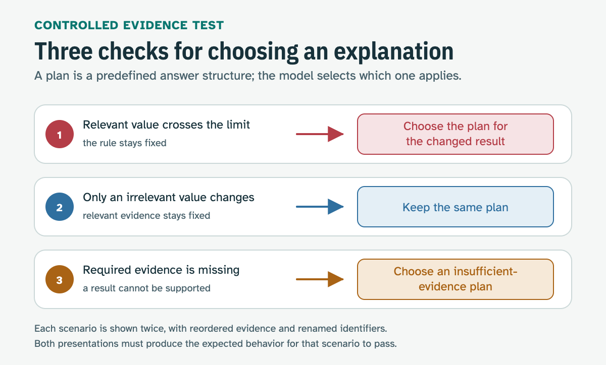
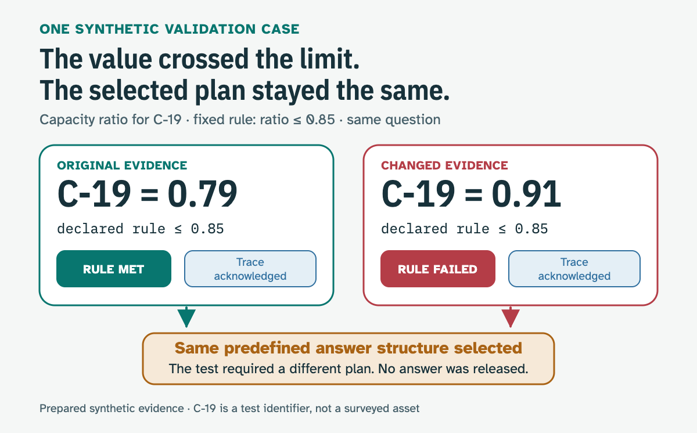

# Why We Added an AI Guide to a Stormwater Tool

*We wanted to make the results easier to work through. Testing the explanation became a project of its own.*

We built GI Scenario Studio to help an engineer compare green-infrastructure options before taking them into a closer site review. A rain garden or a patch of permeable pavement can change how much water reaches a drainage outlet and how quickly it arrives. The engineer still has to work out whether those changes meet the project's requirements and justify the cost.

The calculations come from the US Environmental Protection Agency's [Storm Water Management Model, or SWMM](https://www.epa.gov/water-research/storm-water-management-model-swmm). You describe a drainage network, the land draining into it, and the rain you want to test. SWMM calculates the response. That gives us a way to compare alternatives under the same assumptions, although an engineer still needs to establish whether those assumptions represent the site well enough for the decision.

Two results matter to the example here. **Volume** is the total water passing through the outlet over a storm. **Peak flow** is the fastest rate at which it passes through. A design can reduce total volume while increasing that peak. If we show only the volume reduction and the price, we leave out something the engineer may need to act on.

Our synthetic teaching project, Cedar Trace, contains just such an option. It is inexpensive relative to the exercise's budget and reduces modeled outlet volume, but it fails the requirements we set. We wanted someone looking at the result to be able to ask why, follow the explanation to its source, and decide what to inspect next. We called that proposed conversational feature the Evidence Guide.

## The inexpensive option still failed the brief

Cedar Trace is a teaching model with four synthetic storms and a set of possible GI deployments. Its costs and decision rules belong to the exercise. It does not represent a real municipality or a calibrated drainage system.

One alternative, `ALT-017`, has a screening cost of $54,990 and reduces aggregate outlet volume across the four storms by 4.14%. Those are useful numbers to see together. They are also an incomplete answer to whether the option meets the brief.

We had set four requirements. The table shows what happens when we apply all of them to the same alternative.

<table id="alt017-rules" class="rules-table">
  <caption>ALT-017 against the four teaching rules</caption>
  <thead>
    <tr><th scope="col">Requirement</th><th scope="col">Recorded result</th><th scope="col">Outcome</th></tr>
  </thead>
  <tbody>
    <tr data-rule="aggregate_volume_reduction"><th scope="row">Reduce four-storm outlet volume by at least 6%</th><td>4.14% reduction</td><td>Fails</td></tr>
    <tr data-rule="present_value_cost_cap"><th scope="row">Keep screening cost at or below $200,000</th><td>$54,990</td><td>Passes</td></tr>
    <tr data-rule="no_outfall_peak_increase"><th scope="row">Do not increase outlet peak flow in any selected storm</th><td>Long event: 3.14 → 3.21 cfs Stress event: 13.33 → 13.34 cfs</td><td>Fails</td></tr>
    <tr data-rule="solver_qa"><th scope="row">Accept numerical checks for every storm run</th><td>All 4 runs accepted</td><td>Passes</td></tr>
  </tbody>
</table>

The peak values are in cubic feet per second, abbreviated cfs. Both increases violate this exercise's no-increase rule; the larger change occurs in the long event. Passing the numerical checks means the runs satisfied the checks we declared. It does not make the alternative pass the volume or peak requirements.

This is the reading problem we were trying to solve. The chart, cost record, storm comparison, and numerical checks can each be correct while someone looking at only one of them comes away with the wrong impression. In this case, a useful explanation needs to connect the low price to the two reasons the alternative fails.

## We wanted to make those connections easier to follow

The app already has an Evidence Rail: a side panel where a reader can inspect the record behind a result. It connects a metric to its storm and run, the model changes that produced it, the available files, and the assumptions that affect its interpretation.

That gives an engineer a way to check our work. It also gives them several things to read. To explain this alternative's failure, they need to connect the volume target to the aggregate result, then open the storm comparisons to find the peak increases. The cost record answers a different part of the question.

We thought a conversation might help with that navigation. Someone could select the alternative, ask why it failed, then follow up about the long storm. The Guide would keep the explanation tied to the same evidence already available in the panel. It would be useful only if it saved some of the effort of connecting those records without changing their meaning.

We hadn't measured that benefit with engineers. At this point, it was a product idea we wanted to test. We also had a simpler explanation path available: code could display the recorded rules and results directly. Adding a model needed to improve the experience enough to justify another way for it to go wrong.

## We limited what the model could decide

Our original idea let an assistant read evidence and write an explanation. The difficulty was that copying every number correctly would still leave room for a misleading answer. It could describe a failed option as suitable to advance, leave out a relevant limitation, or suggest a conclusion the records did not establish.

We therefore tested a more constrained design. The model would choose an **explanation plan**, meaning one predefined answer structure from a small menu. Our code would supply the facts, units, approved wording, limitations, and permitted follow-up checks. A separate check would compare the chosen plan and evidence references with what the records supported.

That left the model with a specific job: decide which explanation applied to the question and evidence it received. It couldn't modify a drainage model or approve a design. Keeping the facts in code also meant we could inspect a mistaken choice without having to untangle it from newly generated numbers.

I thought this reduced the chance of a misleading explanation. We still needed to check whether changing a result from meeting a requirement to failing it would make the model choose a different plan. We needed that answer before spending more effort on the conversational experience.

## We changed the evidence and checked the selection

For this experiment, we prepared synthetic evidence records separately from Cedar Trace. Each case contained a question, a decision rule, the fact needed to answer it, and some unrelated facts. The model received the prepared packet directly. We were testing what it did with supplied evidence; finding that evidence in a live engineering project was outside this test.

We tried two fixed model configurations, IBM Granite and Qwen, through [Forge Inference](https://forge.coreweave.com/inference/models). Before examining their results, we defined three behaviors we expected.

<figure id="three-evidence-checks">
  <picture>
    <source media="(max-width: 680px)" type="image/png" srcset="figures/02-listening-tests-mobile.png">
    <source type="image/png" srcset="figures/02-listening-tests.png">
    
  </picture>
  <figcaption>Each check protects a different part of the explanation. Changing plans on every input change would fail the unrelated-value check; always keeping the same plan would fail the rule-crossing check.</figcaption>
</figure>

We presented each case twice, shuffling the evidence order and changing its identifiers. That helped us check whether the result depended on where a fact appeared or what it was called. Both presentations had to behave correctly for a case to pass. We reported a separate 12-case validation group drawn from two different authored project families. The results below use that group; the records do not establish a test kept untouched throughout prompt development.

The expected result came from code applying the declared rule. We did not need a second language model to decide whether a value was above or below a limit. The experiment was narrow enough to check that directly, including whether the chosen answer structure matched the result.

## What happened in the validation group

One validation record described a synthetic pipe labeled `C-19`. The question was whether its recorded capacity ratio met a fixed limit: 0.85 or less. We changed the recorded number from 0.79, which passes that rule, to 0.91, which fails. Qwen returned the same explanation plan for both.

<figure id="recorded-counterfactual">
  <picture>
    <source media="(max-width: 680px)" type="image/png" srcset="figures/01-counterfactual-mobile.png">
    <source type="image/png" srcset="figures/01-counterfactual.png">
    
  </picture>
  <figcaption>This pair comes from the synthetic agent tests, not a Cedar Trace simulation. The unchanged selection shows one specific failure: the explanation did not follow the relevant value across its declared limit.</figcaption>
</figure>

We saw related failures across this group. The table counts cases, with each check requiring both shuffled presentations to pass.

<table id="held-out-results" class="results-table">
  <caption>Correct behavior on 12 synthetic validation cases per model</caption>
  <thead>
    <tr><th scope="col">Required behavior</th><th scope="col">Granite</th><th scope="col">Qwen</th></tr>
  </thead>
  <tbody>
    <tr data-check="threshold_sensitivity"><th scope="row">Change the plan when the relevant value crosses the rule</th><td>1/12</td><td>5/12</td></tr>
    <tr data-check="distractor_specificity"><th scope="row">Keep the plan when only unrelated evidence changes</th><td>6/12</td><td>7/12</td></tr>
    <tr data-check="withheld_target_abstention"><th scope="row">Choose insufficient evidence when the required fact is missing</th><td>10/12</td><td>10/12</td></tr>
    <tr data-check="complete_mechanism"><th scope="row">Pass all three checks</th><td>0/12</td><td>3/12</td></tr>
  </tbody>
</table>

Both models were more consistent at declining to answer when evidence was missing than at changing the plan when the deciding value crossed its rule. That matters for the feature we wanted. An engineer asking about a changed result needs the explanation to change for the right reason.

These are results for two configurations on a small synthetic test set. They gave us a reason to keep those configurations disabled; they do not rank the models for engineering work in general. A separate run of our deterministic rule logic passed every scheduled control check, which confirmed that the expected behavior could be expressed by the test machinery. We still had no comparison of how useful either explanation would be to an engineer.

## Agent Lens and Weave let us inspect what the model received

We used [W&B Weave](https://docs.coreweave.com/products/wandb/weave) and [Agent Lens](https://docs.coreweave.com/products/agent-lens) inside CoreWeave Forge to record the calls made during the experiment. A trace connects the input, provider response, selected plan, usage, and validation result so we can inspect an individual attempt after the run finishes.

For the pipe example, the [original trace](https://forge.coreweave.com/agent-lens/wandb/gi-scenario-studio-agent-evals/conversations/eval-b947d0f5f6cc-b4b4f0b55e0be263f769ab671df06e51) and [changed trace](https://forge.coreweave.com/agent-lens/wandb/gi-scenario-studio-agent-evals/conversations/eval-b947d0f5f6cc-d08af8ce08a97ab002c5a27177fde786) let us check that the deciding value and rule were present, then see the plan the model selected. Both calls had acknowledged traces. The records made the mistake inspectable; the correctness check came from comparing the selection with the declared rule.

We could inspect a case where the model had received the relevant evidence and still selected the wrong structure. It did not tell us why the model made that choice, but it identified behavior that a revised configuration would need to improve.

Across the completed experiment, every scheduled provider call returned and received a trace acknowledgement. Those counts are recorded separately from the behavior scores in the [methods notes](methods.md). The notes also retain an output-format diagnostic and a W&B Table publication failure. We were able to rebuild that publication from the saved results without making new model calls, which was a practical benefit of keeping the attempt records.

## The engineering question is still the point

At the end of this study, we left the tested model configurations disabled and kept the deterministic Evidence Rail available. No generated answer from the study was released. We could continue showing an engineer the actual rule, result, storm, and supporting evidence while we investigated the explanation problem.

The experiment evaluated interpretation of supplied synthetic records. It did not test live retrieval, application safety, resistance to hostile prompts, hydraulic accuracy, or practitioner usefulness. Cedar Trace's modeled runoff results also do not establish field flooding, water quality, groundwater recharge, habitat, or other ecological outcomes. Those require their own evidence.

For a future Guide, I would want the evidence-change checks to pass before putting it in front of engineers. Then I would ask engineers to work through realistic cases using the existing panel and the proposed Guide. Can they identify why an alternative fails, find the relevant run, explain the limitations, and do that with less effort? That comparison has not happened yet.

We started with a problem of reading several engineering results together. The app can already preserve and expose those results. Whether a conversation makes them easier to use is the part we still need to demonstrate.
